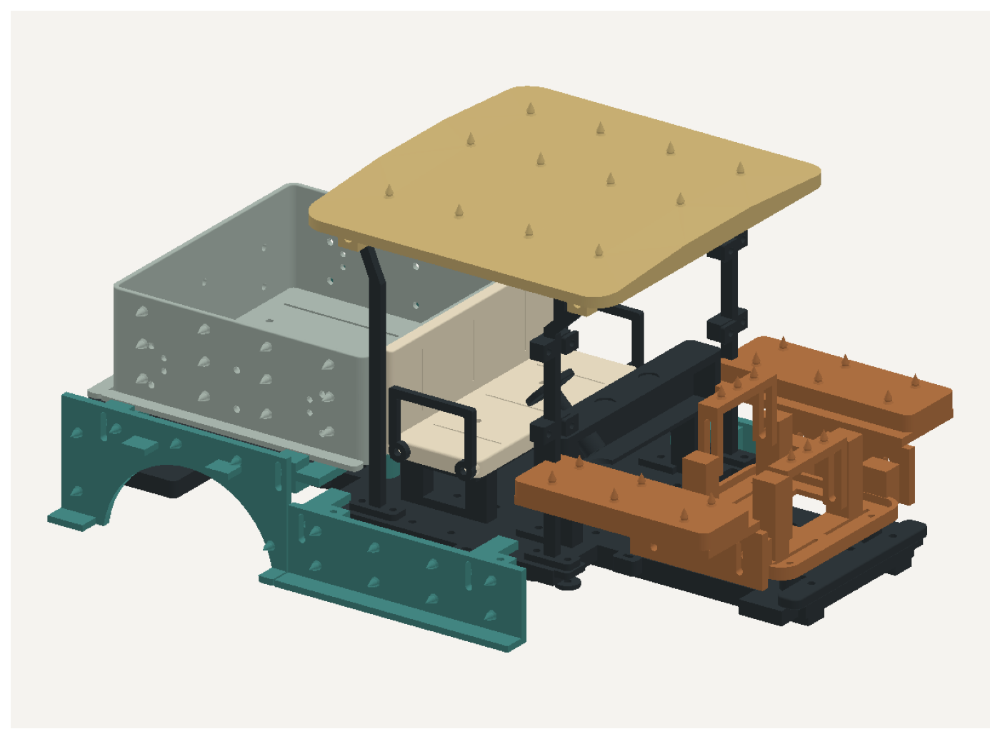

# IT DEPT Pumpkin Cart

A PLA pumpkin-bodied utility cart built on an MN82 RC chassis, with an insert-mounted frame, cab, roof, bed, adjustable hood supports, and removable side runners.

**Release 1.0.0 — October 19, 2026.** Branden confirmed that the parts fit and the cart is assembled. This records assembly fit on his build; pumpkin retention, loaded driving, and long-term durability are not yet confirmed by that report.

## Start here

1. Open [the complete illustrated build guide](Documentation/Build_Guide.pdf): 37 pages / 55 steps. Insert maps begin on page 2; assembly begins on page 17.
2. Use [the print manifest](Parts/PRINT_MANIFEST.csv) to identify pieces and quantities. Each system has its own STL folder and README.
3. Print [the current pumpkin stencils](Stencils/Pumpkin_Cutting_Stencils.pdf) at **Actual Size / 100%**. Verify the 100 mm ruler before cutting.
4. Complete the guide's page 36 checklist, attach pumpkin, and recheck steering/suspension clearance.

## Organized systems

| Folder | Contents |
|---|---|
| `Parts/01_Frame` | Successful flat-floor revision and four splice plates |
| `Parts/02_Chassis_Mounts` | Adapters and shims; keep the fitted spacer-only front mount |
| `Parts/03_Cab_Seat_Dashboard` | Seat, pedestal, arms, dashboard and steering wheel |
| `Parts/04_Roof_Windshield` | R2 spiked roof, posts and windshield clamps |
| `Parts/05_Bed` | R2 50 mm bed and four 16 mm spacers |
| `Parts/06_Hood_Fenders` | HF2 raised bars, carrier, risers, pads and 9 mm spacers |
| `Parts/07_Side_Runners` | SR1 cab skirts, rear arches, clamps, hangers and offsets |
| `Parts/08_Bumpers_Lights_Plaques` | Bumpers, rear slider blocks, LED bezels and plaques |
| `Parts/09_Optional_Cargo` | Miniature IT equipment and toolbox |
| `Parts/10_Fit_Tests` | Insert, peg, mount and pumpkin spike test pieces |
| `Documentation` | Master guide, insert illustrations, hardware list and release notes |
| `Stencils` | Complete current cutting PDF and fitting instructions |
| `Source` | Editable CadQuery generators, module STEP assemblies and historical CAD checks |

The curated `Parts` tree is the release's printing source of truth. Obsolete bed, roof, low hood carrier and 20 mm bed spacers are excluded. Filenames retain their original part numbers to match the guide; numbers repeat between systems.

## Current configuration

- Flat v06 frame: 7 mm web, reinforced underside rails, M3 insert pockets and wiring loops.
- R2 bed/roof: 50 mm bed walls and 6 mm projecting pumpkin spikes.
- HF2: two raised, height-adjustable hood contact bars; adjustable front fender pads.
- SR1: clamp-on cab skirts and bed-bolt-mounted rear arch hangers.
- Bed stack: **floor -> 16 mm spacer -> 4 mm hanger -> bed**.
- Front adapter is optional and omitted from Branden's fitted configuration. Retain the actual chassis mounting hardware and spacer heights that worked.

## Hardware and printing

See [hardware totals](Documentation/HARDWARE.csv) and guide pages 15-16. Nominal complete kit: 77 M3 screws/inserts with both adapters, or 75 with the front adapter omitted, plus original truck/direct-mount hardware. Panel offset spacers require changed screw lengths.

Use your successful PLA slicer profile. No machine-specific G-code or unverified Bambu profile is supplied. All parts are in millimeters. Preserve the supplied orientations, inspect supports around spikes/overhangs, and verify insert fit using the coupon. Nominal insert pockets assume 4.6 mm OD x 5.7 mm long inserts; M3 alone does not define insert outside dimensions.

## Pumpkin cutting

The stencil PDF covers bed sides/rear, roof, cab skirts, rear arches, front fender footprints, and an HF2 hood fitting reference. A hollow pumpkin shell cannot be fully defined by one flat outline; finish its exterior against the assembled adjustable supports. Start with 8-10 mm or more flesh at the 6 mm spikes and trial-fit paper first. The obsolete 30 mm hood-cap stencil is excluded.

## Editable design and publication

Read [Source/README.md](Source/README.md) before regenerating CAD. See [the GitHub publication plan](Documentation/GITHUB_PUBLISH_PLAN.md). No GitHub repository has been created by packaging this release. No open-source license is assigned yet; choose one before a public release.
